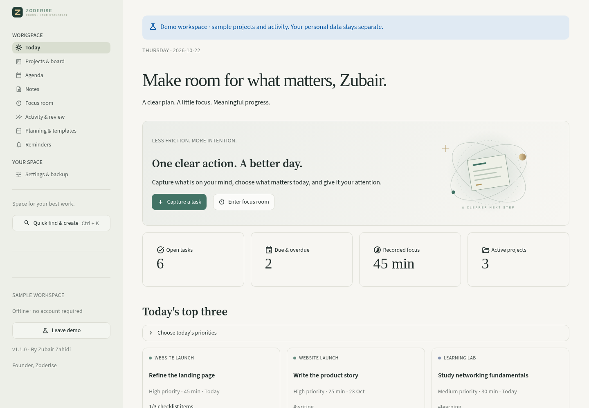

<p align="center"></p>

<h1 align="center">Space for your best work.</h1>
<p align="center">A local productivity workspace for projects, ideas, and focused progress.<br>Created by <a href="https://github.com/Zubair-zahidi">Zubair Zahidi</a>, founder of Zoderise.</p>

<p align="center"><a href="https://github.com/Zubair-zahidi/zoderise-focus/actions/workflows/tests.yml"></a>   </p>

<p align="center"><a href="https://github.com/Zubair-zahidi/zoderise-focus/releases">Downloads</a> · <a href="docs/USER_GUIDE.md">User guide</a> · <a href="docs/ARCHITECTURE.md">Architecture</a> · <a href="SECURITY.md">Security</a></p>


Focus brings projects, notes, planning, and focused work into one local workspace. Capture a task, move it through your board, keep its references in Markdown notes, and give it a focused session. The workspace works without an account, cloud service, or AI model.

## See it in action


The screenshots and animated tour show the app's **separate sample workspace**. Its projects and activity are fictional examples, labelled in the interface. Your personal workspace starts empty.

## What you can do

| Area | Facilities in version 1.1 |
| --- | --- |
| Projects & tasks | Drag-and-drop Kanban with keyboard alternatives; manual card order; prerequisites with cycle protection; priorities, deadlines, estimates, checklists, tags, and project archive |
| Recurring work | Daily, weekly, weekdays, selected weekdays, monthly, and custom intervals; one follow-up per completed occurrence |
| Agenda | Overdue, today, next seven days, and later views; manual `.ics` calendar export |
| Notes | Searchable project-linked Markdown; typing autosave; recoverable drafts; last 50 published versions; preview and `.md` downloads |
| Focus room | Task-linked or independent timer; pause/resume; finish early; optional break countdown; persisted active session |
| Daily planning | Today's top three; separate planned dates and deadlines; weekly calendar; editable focus goal and intention |
| Reusable workflows | Built-in project templates; save your own task/checklist templates; compare estimates with recorded completed sessions |
| Review | Fourteen-day activity chart; seven-day completed work; recorded session history; downloadable weekly review |
| Quick access | Ctrl+K search; quick capture page; optional Windows Ctrl+Alt+Space capture shortcut |
| Appearance | Four accents, compact spacing, reduced motion, light/dark themes; English, Dari, and Pashto core controls with RTL layouts |
| Reminders | Optional deadline, completed-session, and break reminders; persistent inbox; Windows notifications while the native app is open |
| Local control | JSON/CSV exports; ZIP and password-encrypted backup exports; restore change preview; pre-restore safety copy; daily/weekly local backups with retention |
| Recovery | Reversible task/note trash and archived projects; demo data stays separate |

Calendar export is a file, not a live sync. Activity totals represent completed timer sessions, not measured attention or computer monitoring. Dari/Pashto translate core controls; extended help can fall back to English. User content is preserved and calendar dates are Gregorian.

## Run from source

Use Python **3.12–3.14**. Windows, macOS, and Linux can run the browser app; the packaged desktop download targets Windows x64.

```powershell
git clone https://github.com/Zubair-zahidi/zoderise-focus.git
cd zoderise-focus
python -m venv .venv
.\.venv\Scripts\Activate.ps1
python -m pip install -r requirements.txt
python -m streamlit run app.py
```

On macOS/Linux, activate with `source .venv/bin/activate`. Open **http://127.0.0.1:8650**. Dependencies are downloaded during installation; normal use after installation works offline.

## Windows desktop

Download [Zoderise Focus for Windows x64](https://github.com/Zubair-zahidi/zoderise-focus/releases/download/v1.1.0/Zoderise-Focus-1.1.0-Windows-x64.exe) and double-click it. It bundles Python and the application dependencies, so end users do not need Python, Node.js, npm, or Ollama. The [release page](https://github.com/Zubair-zahidi/zoderise-focus/releases/tag/v1.1.0) also includes the source ZIP and checksums.

The desktop uses **Microsoft Edge WebView2 Runtime**, commonly present on Windows 10/11. The executable is unsigned; Windows may show an unknown-publisher warning. Check the release checksums and use the original release. Source and desktop versions use the same local data directory. See [desktop build instructions](docs/DESKTOP.md) for prerequisites and packaging.

## Your data

- Windows: `%LOCALAPPDATA%\ZoderiseFocus\workspace.sqlite3`
- macOS/Linux: `~/.local/share/zoderise-focus/workspace.sqlite3`
- Test/custom directory: set `FOCUS_DATA_HOME` before launch.
- Sample data: a separate `demo.sqlite3` in the same directory.

The app binds to **127.0.0.1**. It is a personal workspace, not a server for other devices or a hosted multi-user service. No app telemetry, login provider, remote AI, or automatic cloud upload is configured. Notes are rendered without raw HTML; Markdown image syntax is omitted from preview to avoid remote image requests. External links open only when you choose them.

The live database, automatic backups, plain ZIP backups, and ordinary exports are **not encrypted**. Optional `.focus` exports protect a backup with your password using AES-GCM and scrypt. The password is not saved and cannot be recovered. A plain ZIP checksum detects corruption, not sender authenticity. Restore validates fields and references, shows changes, saves a safety copy, and replaces the workspace transactionally.

Automatic backups run while the app is open, with a catch-up check on reopening. Windows reminders and the global shortcut are opt-in; shortcut changes require restarting the native app. Windows notification settings can suppress banners; reminders remain in the app inbox. The browser version has no system-wide shortcut or native notification bridge.

## Development & verification

```powershell
python -m unittest discover -s tests -v
```

The 22-test suite covers navigation, task/note workflows, dependencies, ordering, recurring schedules, templates, drafts and version recovery, timer persistence, backup encryption, retention, old-format import, and restore validation. CI runs on Windows and Linux with Python 3.12 and 3.14. Fresh-browser checks cover drag-and-drop, database draft recovery, encrypted restore previews, RTL layouts, and mobile width. Maintainer capture scripts require Node.js, Playwright, and Edge; app users do not.

## Screenshots

| Project board | Focus room |
| --- | --- |
|  |  |

| Notes | Activity review |
| --- | --- |
|  |  |

[Weekly planning](docs/media/planning.png) · [Templates](docs/media/templates.png) · [Restore preview](docs/media/restore-preview.png) · [Dari](docs/media/dari-board.png) · [Pashto](docs/media/pashto-board.png) · [Mobile](docs/media/mobile-board.png)

## Scope & next steps

Version 1.1 is for an individual using one local workspace. Cloud sync, shared accounts, Horizon AI integration, website blocking, database encryption, and a mobile installer remain outside this release. The layout adapts to small screens; the default server is accessible only on the host device. Future integrations need explicit data-flow and permission design.

Contributions are welcome. Please open an issue with a reproducible example and no private workspace data. See [CONTRIBUTING.md](CONTRIBUTING.md). MIT licensed.

## Restricted cloud workspaces

When the home directory is read-only, set `FOCUS_DATA_HOME` to a writable private directory before launching Streamlit. For example, on Linux: `FOCUS_DATA_HOME=/workspace/focus-data .venv/bin/python -m streamlit run app.py`. The existing data-directory override keeps the application code independent of the cloud filesystem layout.

## Cloud review preview



Captured from the running project on 22 October 2026. The built-in sample workspace is enabled; the sample data is labelled in the interface.

[Mobile capture](docs/cloud-review/mobile-2026-10-22.png)
