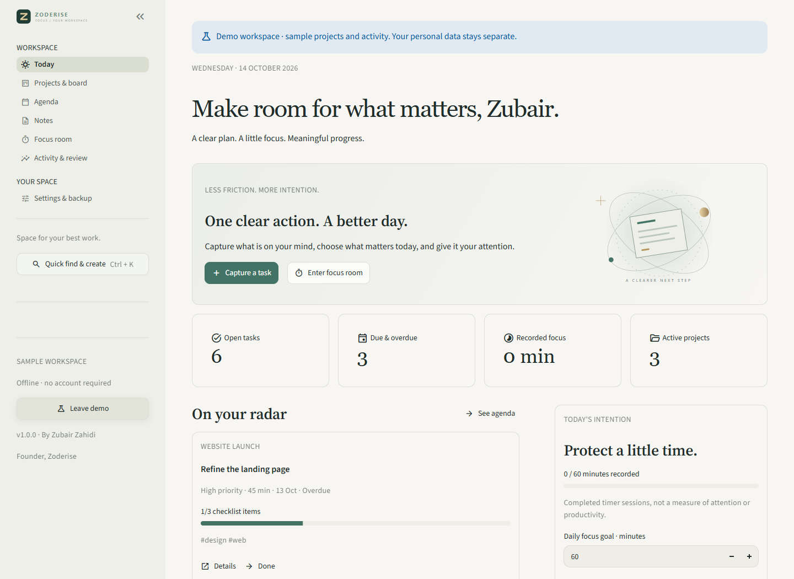
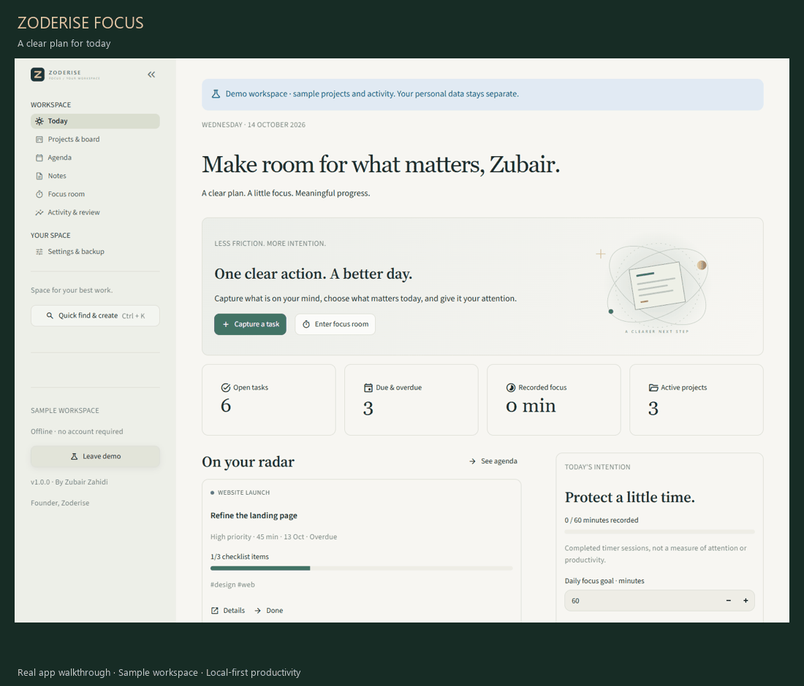
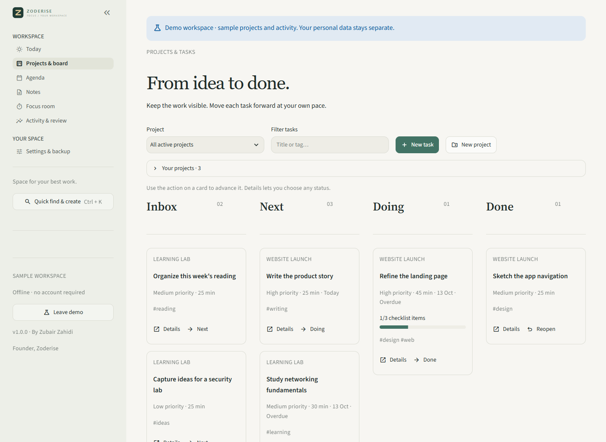
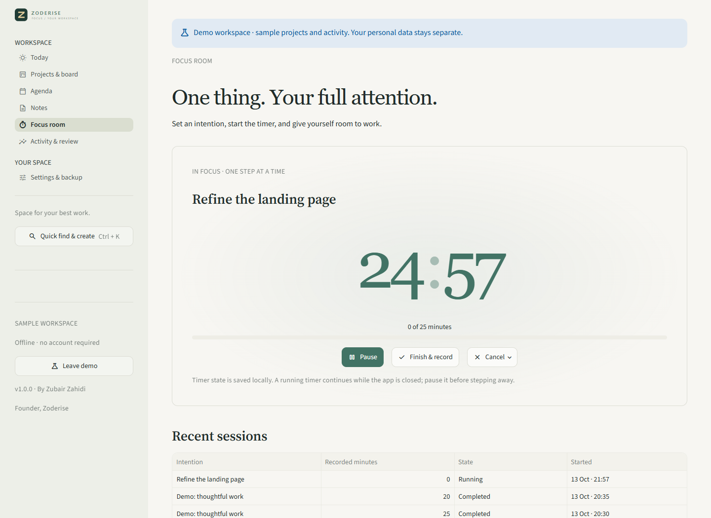
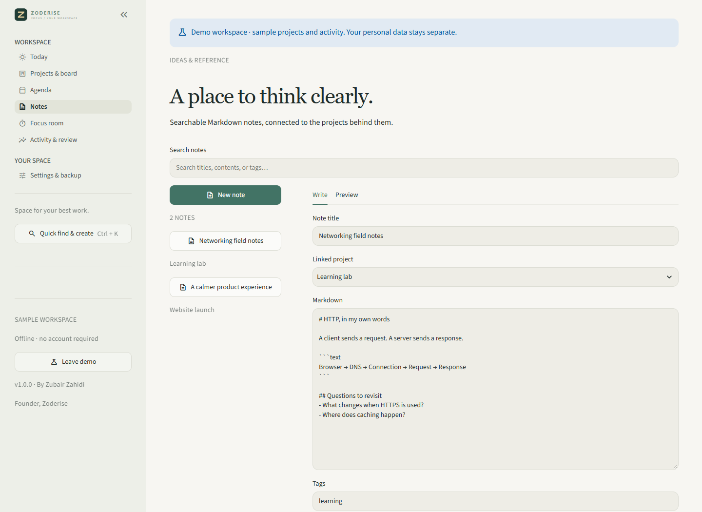
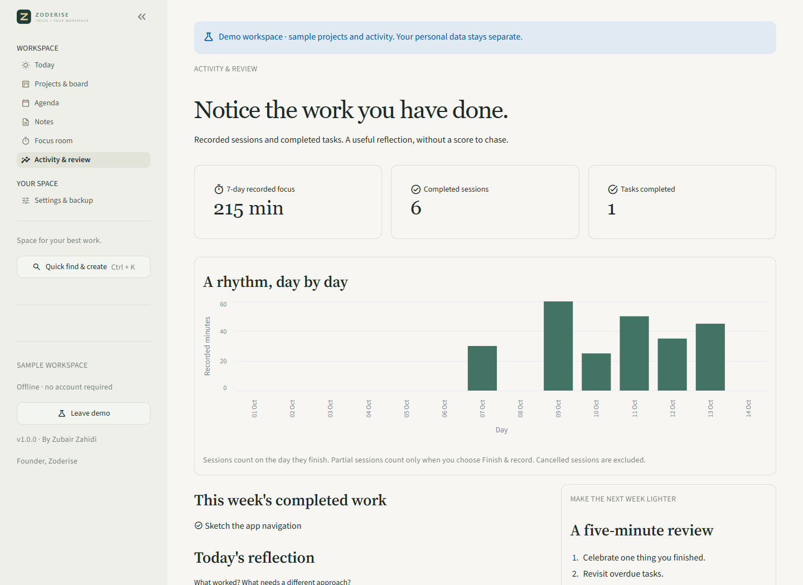

<p align="center"></p>

<h1 align="center">Space for your best work.</h1>
<p align="center">A local productivity workspace for projects, ideas, and focused progress.<br>Created by <a href="https://github.com/Zubair-zahidi">Zubair Zahidi</a>, founder of Zoderise.</p>

<p align="center"><a href="https://github.com/Zubair-zahidi/zoderise-focus/actions/workflows/tests.yml"></a>   </p>

<p align="center"><a href="https://github.com/Zubair-zahidi/zoderise-focus/releases">Downloads</a> · <a href="docs/USER_GUIDE.md">User guide</a> · <a href="docs/ARCHITECTURE.md">Architecture</a> · <a href="SECURITY.md">Security</a></p>



Focus brings the practical parts of getting work done into one quiet place. Capture a task, move it through your board, keep its references in Markdown notes, and give it a focused session. The workspace works without an account, cloud service, or AI model.

## See it in action



The screenshots and animated tour show the app's **separate sample workspace**. Its projects and activity are fictional examples, labelled in the interface. Your personal workspace starts empty.

## What you can do

| Area | Facilities in version 1.0 |
| --- | --- |
| Projects & tasks | Four-column Kanban board; project colors; priorities; due dates; estimates; checklists; tags; searchable task details; project archive |
| Recurring work | Daily or weekly follow-up tasks created on completion, with fresh unchecked checklist items |
| Agenda | Overdue, today, next seven days, and later views; manual `.ics` calendar export |
| Notes | Project-linked Markdown notes; title, content, and tag search; saved-content preview; individual `.md` downloads |
| Focus room | Task-linked or independent timer; pause/resume; finish early; optional break countdown; persisted active session |
| Daily planning | Editable focus goal and written intention/reflection for each day |
| Review | Fourteen-day activity chart; seven-day completed work; recorded session history; downloadable weekly review |
| Quick access | Quick find and create; native Ctrl+K shortcut; task and note search from any page |
| Appearance | Forest, Ocean, Violet, or Copper accents; compact spacing; reduced motion; native light/dark themes |
| Local control | SQLite workspace; JSON/CSV exports; ZIP backups with corruption checks; validated restoration; automatic pre-restore safety copy |
| Recovery | Reversible task/note trash and archived projects; demo data stays separate |

The board uses visible buttons and task details to change status; drag-and-drop is not included. Calendar export is a file, not a live sync. Activity totals represent completed timer sessions, not measured attention, computer monitoring, or a productivity score.

## Run from source

Use Python **3.12–3.14**. Windows, macOS, and Linux can run the browser app; the packaged desktop download targets Windows x64.

```powershell
git clone https://github.com/Zubair-zahidi/zoderise-focus.git
cd zoderise-focus
python -m venv .venv
.\.venv\Scripts\Activate.ps1
python -m pip install -r requirements.txt
python -m streamlit run app.py
```

On macOS/Linux, activate with `source .venv/bin/activate`. Open **http://127.0.0.1:8650**. Dependencies are downloaded during installation; normal use after installation works offline.

## Windows desktop

The intended portable release is `Zoderise-Focus-1.0.0-Windows-x64.exe`. When it is available under [Releases](https://github.com/Zubair-zahidi/zoderise-focus/releases), download and double-click it. It bundles Python and the application dependencies, so end users do not need Python, Node.js, npm, or Ollama.

The desktop uses **Microsoft Edge WebView2 Runtime**, commonly present on Windows 10/11. The executable is unsigned; Windows may show an unknown-publisher warning. Check the release checksums and use the original release. Source and desktop versions use the same local data directory. See [desktop build instructions](docs/DESKTOP.md) for prerequisites and packaging.

## Your data

- Windows: `%LOCALAPPDATA%\ZoderiseFocus\workspace.sqlite3`
- macOS/Linux: `~/.local/share/zoderise-focus/workspace.sqlite3`
- Test/custom directory: set `FOCUS_DATA_HOME` before launch.
- Sample data: a separate `demo.sqlite3` in the same directory.

The app binds to **127.0.0.1**. It is a personal workspace, not a server for other devices or a hosted multi-user service. No app telemetry, login provider, remote AI, or automatic cloud upload is configured. Notes are rendered without raw HTML; Markdown image syntax is omitted from preview to avoid remote image requests. External links open only when you choose them.

Local databases, backup archives, and exports are **not encrypted**. Use device permissions and disk security appropriate to your information. A SHA-256 backup checksum detects corruption; it does not authenticate the sender. Before restoration, the app validates fields and references using its own schema, saves a safety copy, then replaces the workspace in a transaction.

## Development & verification

```powershell
python -m unittest discover -s tests -v
```

The suite covers task capture, note saving, preferences, all seven pages, timer start/pause/finish, demo isolation, recurring-task idempotency, task recovery, timer persistence, exports, and backup validation/restoration. Visual checks use a fresh browser against an isolated local workspace; capture scripts are in `tools/` and require Node.js, Playwright, and a local Edge installation. These tools are for maintainers, not app users.

## Screenshots

| Project board | Focus room |
| --- | --- |
|  |  |

| Notes | Activity review |
| --- | --- |
|  |  |

[Mobile board](docs/media/mobile-board.png) · [Backup controls](docs/media/backup.png) · [Appearance settings](docs/media/settings.png)

## Scope & next steps

Version 1.0 is for an individual using one local workspace. It does not include cloud sync, shared accounts, OS notifications, website blocking, automatic integrations, database encryption, or a mobile installer. The browser layout adapts to small screens, but the default server is only accessible on the host device. Future work can explore keyboard task navigation, richer recurring schedules, and optional encrypted backups without compromising the small, practical first release.

Contributions are welcome. Please open an issue with a reproducible example and no private workspace data. See [CONTRIBUTING.md](CONTRIBUTING.md). MIT licensed.
